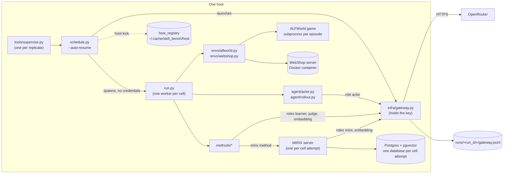
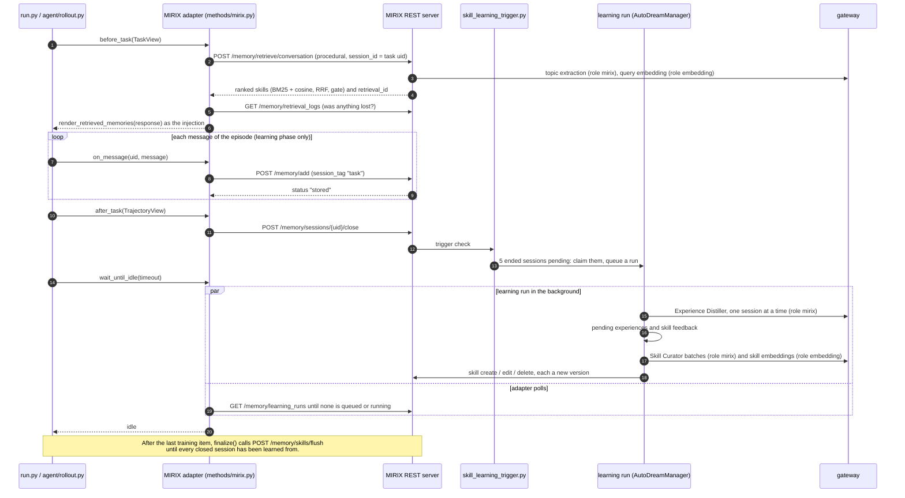
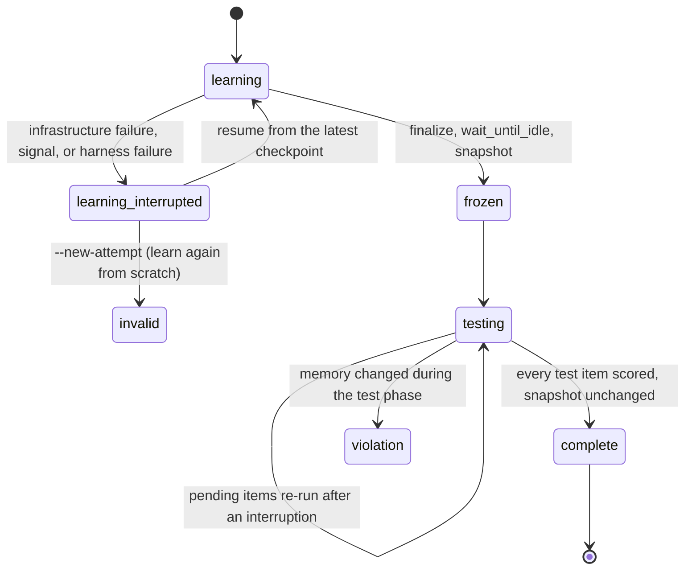
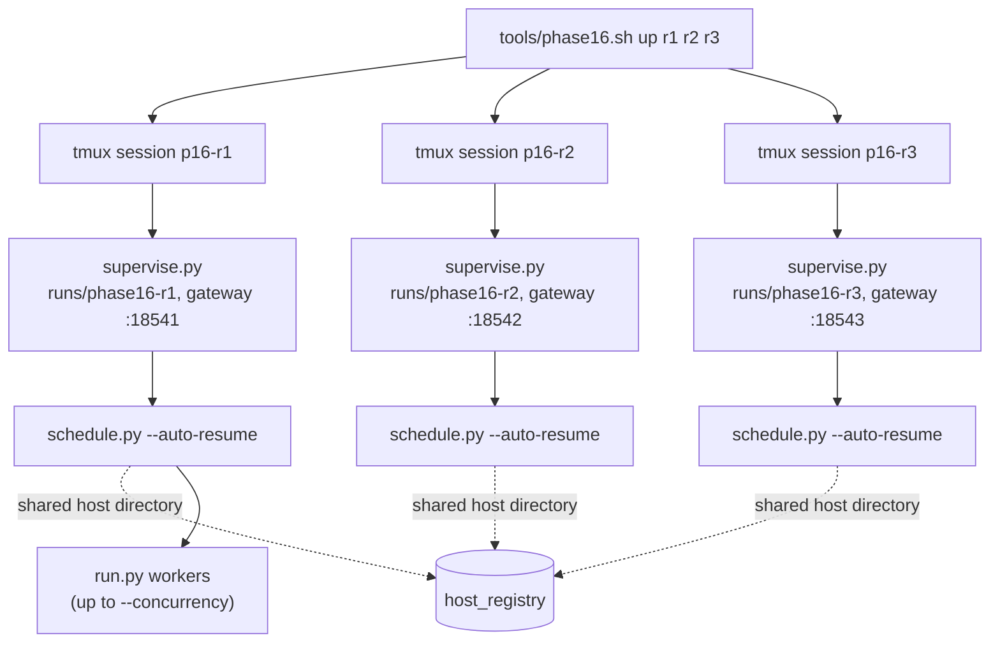

# skill_bench architecture

`evals/skill_bench/` is an evaluation harness for agent memory. It measures how an agent does on held-out tasks after a memory method has learned from a stream of earlier tasks. This document explains two things:

- how MIRIX's procedural (skill) memory works when the harness drives it;
- how the harness runs, records, checks and summarises an experiment.

For setup, commands and the reproduction procedure, see [README.md](README.md).

Code is cited by path and by function or class name, so you can search for it. All paths are relative to the repository root unless they start with a harness subdirectory such as `envs/`, `methods/` or `infra/`, which are relative to `evals/skill_bench/`.

## Contents

1. [Overview and repository layout](#1-overview-and-repository-layout)
2. [MIRIX as the benchmark uses it](#2-mirix-as-the-benchmark-uses-it)
3. [The procedural (skill) learning pipeline](#3-the-procedural-skill-learning-pipeline)
4. [Harness architecture](#4-harness-architecture)
5. [Security model](#5-security-model)

---

## 1. Overview and repository layout

### 1.1 What is measured

A **cell** is one benchmark, one model and one memory method. Each cell runs in three stages:

1. **Learning.** The agent plays the training tasks one at a time. The memory method sees each episode's messages as they are produced and may update its memory.
2. **Memory frozen.** The method finishes any pending learning, and the harness stores a snapshot of the memory.
3. **Test.** The agent plays the held-out test tasks. The method may only read its memory. At the end, the harness checks that the memory still equals the snapshot.

The released study covers these dimensions:

| Dimension | Values |
|---|---|
| Benchmarks | ALFWorld, WebShop |
| Models (OpenRouter) | `luna` = `openai/gpt-6-luna`, `luna56` = `openai/gpt-5.6-luna` |
| Methods | `none` (no memory), `reasoningbank` (ReasoningBank), `awm` (Agent Workflow Memory), `mirix` (MIRIX procedural memory) |
| Replicates | three runs directories, r1 to r3, with identical cell ids |

That is 2 × 2 × 4 = 16 cells per replicate. The benchmarks, splits, step caps, models and call parameters are defined in the study constants module (`evals/skill_bench/protocol.py`). The named cell selections are in `evals/skill_bench/study.py` (`STUDIES`).

### 1.2 Repository layout

**MIRIX, the memory system (`mirix/`)**

| Path | Role |
|---|---|
| `mirix/server/rest_api.py` | FastAPI REST server (`app`, `lifespan`) and every endpoint the harness calls |
| `mirix/server/server.py` | `AsyncServer`, the process-wide server singleton (`get_server`) |
| `mirix/agent/` | Agent step loop; `meta_agent.py` (`MetaAgent`) coordinates the memory sub-agents |
| `mirix/orm/`, `mirix/schemas/`, `mirix/services/` | Data layers: SQLAlchemy models, Pydantic schemas, async managers |
| `mirix/prompts/system/base/` | System prompt of each agent, including the skill curator and the experience distiller |
| `mirix/functions/function_sets/memory_tools.py` | Tools the memory agents call, including the skill tools |
| `mirix/client/remote_client.py` | `MirixClient`, the Python client the harness uses |
| `mirix/client/render.py` | `render_retrieved_memories`, the text that is injected into the agent's prompt |
| `mirix/queue/` | Queue for conversation memory. Task sessions do not use it. |
| `scripts/start_server.py` | Server launcher. The harness starts one server per cell attempt with it. |

**The harness (`evals/skill_bench/`)**

| Path | Role |
|---|---|
| `protocol.py` | The study constants module: benchmarks, split sizes, step caps, models, call parameters, pinned sha256 values of templates, splits and vendored code |
| `study.py` | Named cell selections (`STUDIES`: `phase16`, `phase16-pilot`, `phase16-dev`) |
| `run.py` | One cell end to end (`CellRunner`) |
| `schedule.py` | Runs many cells as `run.py` worker processes behind one gateway |
| `host_registry.py` | Coordinates several schedulers on one host |
| `cell_records.py` | Cell directory layout, attempt states, status values and exit codes |
| `audit.py` | Offline checks of a runs directory |
| `report.py` | Offline report of one runs directory |
| `agent/` | The actor (`actor.py`), rollout loops (`rollout.py`) and trajectory records and views (`trajectory.py`) |
| `envs/` | Shared contract (`base.py`), `alfworld.py`, `webshop.py`, `agent_context.py`, plus `templates/`, `splits/` and `vendor/` |
| `methods/` | Method contract (`base.py`), the adapters `none.py`, `reasoningbank.py`, `awm.py` and `mirix.py`, the shared judge (`judge.py`), and their prompts and templates |
| `infra/` | `gateway.py`, `mirix_server.py`, `compose.yaml` and `init.sql` (Postgres), `resources.py`, `failures.py`, `processes.py`, `tokens.py`, the systemd user unit template `skill-bench@.service.in` |
| `tools/` | `supervise.py`, `phase16.sh`, `preflight.py`, `aggregate_replicates.py`, `fetch_models.py`, `summarize_learning.py`, `prepare_webshop.py`, and `sync_runs.py` (merges runs directories from several hosts into one read-only view) |
| `config/models.json` | OpenRouter metadata of the models: context window, maximum output, pricing |
| `tests/` | Harness tests. All model traffic goes to a fake upstream (`tests/fakes.py`). |
| `runs/`, `data/` | Run output and downloaded data. Git ignores both (`.gitignore`). |

### 1.3 Components at run time



---

## 2. MIRIX as the benchmark uses it

### 2.1 The REST server

`mirix/server/rest_api.py` defines the FastAPI `app`. Its `lifespan` does the following at startup:

1. `initialize()`:
   - preloads the `o200k_base` tokenizer;
   - builds the `AsyncServer` singleton (`get_server()`) and calls `ensure_defaults()`;
   - starts the in-process queue and LangFuse (when configured).
2. It then starts three background tasks:
   - the session sweeper (`SessionSweeper` in `mirix/services/skill_learning_trigger.py`);
   - the skill re-embedder (`SkillRetrievalReembedder`);
   - the retrieval-log purger (`RetrievalLogPurger`).

Each cell attempt gets its own server process. `infra/mirix_server.py` starts it with `default_command`, which runs `scripts/start_server.py --host … --port …`. MIRIX's endpoints and managers are async (`docs/Mirix_async_native_changes.md`).

### 2.2 Endpoints the harness calls

The MIRIX method adapter (`methods/mirix.py`, class `MirixApi`) calls MIRIX only through MIRIX's own client, `MirixClient`. The client is created with `max_retries=0`, so a failed write is never repeated behind the harness's back.

| Method hook | `MirixClient` call | Endpoint |
|---|---|---|
| `setup` | `openapi()` (feature check, `missing_features`) | `GET /openapi.json` |
| `setup` | `initialize_meta_agent()` (first creates the organization and the client) | `POST /organizations/create_or_get`, `POST /clients/create_or_get`, `POST /agents/meta/initialize` |
| `setup` | `create_or_get_user()` | `POST /users/create_or_get` |
| `setup` (test-phase resume) | `list_agents()` | `GET /agents` |
| `before_task` | `retrieve_with_conversation()` | `POST /memory/retrieve/conversation` |
| `before_task` | `list_retrieval_logs()` | `GET /memory/retrieval_logs` |
| `on_message` | `add()` | `POST /memory/add` |
| `after_task` | `close_session()` | `POST /memory/sessions/{session_id}/close` |
| `wait_until_idle` | `list_learning_runs()` | `GET /memory/learning_runs` |
| `finalize` | `flush_skills()`, `get_learning_run()` | `POST /memory/skills/flush`, `GET /memory/learning_runs/{run_id}` |
| `snapshot` | `list_memory_components()`, `get_skill_history()`, `get_skill_version()` | `GET /memory/components`, `GET /memory/skills/{skill_id}/history`, `GET /memory/skills/{skill_id}/versions/{version_no}` |

### 2.3 The meta agent and its sub-agents

`POST /agents/meta/initialize` creates a parent `meta_memory_agent` and one child per memory agent (`mirix/services/agent_manager.py`).
- The default child list is `CreateMetaAgent.agents` in `mirix/schemas/agent.py`: core, resource, semantic, episodic, procedural and knowledge-vault memory agents, plus the reflexion and background agents.
- Each agent's system prompt is loaded from `mirix/prompts/system/base/<agent_name>.txt`.
- `MetaAgent` (`mirix/agent/meta_agent.py`) is the in-process class that coordinates these agents for conversation memory.

The benchmark uses only part of this machinery:

| Agent | Role in the benchmark |
|---|---|
| `meta_memory_agent` | Owns the learning scope. Each task session is recorded under this agent's id. Task sessions are never passed to it as input (§3.1). |
| `procedural_memory_agent` | Acts as the **skill curator** inside learning runs (§3.5). |
| `auto_dream_agent` | Created lazily by `AutoDreamManager.get_or_create_dream_agent_state`. Learning runs (`mode="procedural"`) execute through `AutoDreamManager`. |
| other memory agents | Created, but no task session reaches them |

The harness sends the meta agent only two configuration blocks (`meta_agent_config` in `methods/mirix.py`; `methods/templates/mirix/setup.json`):

- the LLM configuration: endpoint type `openai`, pointing at the gateway role `mirix`, with the cell's model, context window and maximum output;
- the embedding configuration: endpoint type `openrouter`, model `google/gemini-embedding-001`, pointing at the gateway role `embedding`.

Every other MIRIX setting keeps its default.

### 2.4 The six memory components

| Component | ORM model (table) | Manager | Holds |
|---|---|---|---|
| Core | `mirix/orm/block.py` (`block`) | `BlockManager` | Labelled blocks that sit in the agent's context |
| Episodic | `mirix/orm/episodic_memory.py` (`episodic_memory`) | `EpisodicMemoryManager` | Time-stamped events with a summary and details |
| Semantic | `mirix/orm/semantic_memory.py` (`semantic_memory`) | `SemanticMemoryManager` | Concepts and facts, independent of when they were learned |
| Procedural | `mirix/orm/procedural_memory.py` (`procedural_memory`) | `ProceduralMemoryManager` | **Skills**: name, entry type, description, instructions, triggers, examples |
| Resource | `mirix/orm/resource_memory.py` (`resource_memory`) | `ResourceMemoryManager` | Documents and files, with a summary and content |
| Knowledge Vault | `mirix/orm/knowledge_vault.py` (`knowledge_vault`) | `KnowledgeVaultManager` | Verbatim structured items such as contacts or credentials. A retrieval never returns the secret values. |

The MIRIX method retrieves only procedural memory (`memory_types: ["procedural"]`), and task sessions feed only skill learning (§3.1).

### 2.5 PostgreSQL and pgvector

MIRIX stores everything in PostgreSQL:
- **Connection.** The URI comes from `MIRIX_PG_URI` (`mirix/settings.py`). Each server pools up to 80 + 30 connections (`pg_pool_size`, `pg_max_overflow`).
- **Vectors.** Embeddings are pgvector columns, padded to `MAX_EMBEDDING_DIM` (4096) in `mirix/constants.py`.
- **Tables** are created at startup.

The harness runs one Postgres container for all cells (`infra/compose.yaml`):
- the image is `pgvector/pgvector:pg16`, pinned by digest;
- `max_connections` is 2000;
- the database is published on loopback only.

`infra/init.sql` builds a template database, `skill_bench_template`, with the `vector`, `pg_trgm` and `uuid-ossp` extensions. Each cell attempt clones its own database from it (§4.7).

---

## 3. The procedural (skill) learning pipeline



### 3.1 How a finished task is recorded

The adapter records every method-visible message as soon as the rollout produces it (`MirixMethod.on_message`):

```text
add(messages=[message], session_id=<opaque task uid>, session_tag="task")
```

The first add of a learning session also carries `agent_context`, the actor's prompt template as static text (§4.3). The messages of test-phase episodes are never sent to MIRIX.

On the server, `add_memory` calls `_run_add_pipeline`, which works in this order:

1. **Parse.** The payload is parsed and its images checked. Nothing is written yet.
2. **Resolve the session tag.** The first write of a session fixes its tag. A `task` session needs a `session_id` and at least one user, assistant or tool turn; otherwise MIRIX answers HTTP 422.
3. **Ensure the user.** `create_or_get_user` runs before any write of the user's data.
4. **Store and check.** `_ingest_session_turns` writes the turns to the **Conversation Message Store**:
   - `conversation_message` keeps one row per turn, with its real role;
   - `conversation_session` keeps one lifecycle row per session, including the `agent_context`.

   The skill-learning trigger check then runs.

A `task` session ends here, and the answer is `status: "stored"`. It is never queued for the meta memory agent. Its only use is skill learning.

`MirixMethod.after_task` then calls `close_session(uid)`. `POST /memory/sessions/{id}/close` records the end of the session and runs the trigger check again. In a cell, the session idle timeout is set to ten years (`MIRIX_SESSION_IDLE_TIMEOUT_SECONDS` in the study constants module), so a session ends only through this explicit close.

### 3.2 The learning trigger

The trigger lives in `mirix/services/skill_learning_trigger.py`. A check runs at three points:

- after every task-session write;
- after an explicit session close;
- from `SessionSweeper`, the background loop that also reclaims runs whose lease expired.

A check fires when at least `SKILL_TRIGGER_SESSION_THRESHOLD` task sessions (`mirix/constants.py`, default 5) are pending in one scope. Pending means ended and not yet distilled; the scope is one (organization, user, meta agent). The claim is atomic (`AgentTriggerStateManager.check_and_claim_fire`). It creates a `skill_learning_run` row in state `queued`. The row stores a watermark per claimed session: rows written after the claim stay pending for a later run. `schedule_learning_run` then executes the run in the background (`execute_learning_run` → `AutoDreamManager.run(mode="procedural", run_id=…)`).

`flush_skills` (`POST /memory/skills/flush`) claims every pending session, however few there are. It also starts a run for experiences that an earlier run left waiting for the curator.

Runs are protected in two ways:
- **Leases.** A running run refreshes its heartbeat every 30 s (`LEARNING_RUN_HEARTBEAT_SECONDS`). A run whose lease lapses is reclaimed as failed, and its sessions become claimable again (`SkillLearningRunManager`).
- **One run at a time per scope.** Runs of one (user, organization) are serialized by `_procedural_dream_guard` in `mirix/services/auto_dream_manager.py`. The guard holds a process-local asyncio lock and a Postgres advisory lock.

In the benchmark, the adapter's `wait_until_idle` polls until no run is queued or running. Learning therefore happens between learning items, never during an episode.

### 3.3 The body of a learning run

`AutoDreamManager._process_learning_run` takes these steps:

1. **Distill.** Each claimed session's rows up to the watermark are distilled into pending `skill_experience` rows. Sessions are processed in parallel, up to the distiller's concurrency limit.
2. **Commit.** Each session is committed atomically, and only while the run is still active (`SkillLearningRunManager.commit_distilled_session`). One transaction inserts its experiences and marks exactly those rows distilled. A cancelled or reclaimed run therefore never duplicates experiences.
3. **Settle failures.** A session that could not be distilled is settled:
   - an infrastructure error backs it off (`distill_retry_after`) and is not counted;
   - any other failure counts once;
   - after `DISTILL_MAX_FAILURES` (3) counted failures the session is retired.
4. **Record metrics.** Per-session metrics and LLM usage are written to the run row.
5. **Curate.** All pending experiences of the scope are curated (`_curate` → `curate_pending_experiences` in `mirix/services/skill_experience_curator.py`).

### 3.4 The Experience Distiller

| | |
|---|---|
| Code | `mirix/services/session_experience_distiller.py` (`SessionExperienceDistiller`) |
| Prompt | `mirix/prompts/system/base/auto_dream_agent/procedural.txt` (`_load_distiller_prompt`) |
| Transcript rendering | `mirix/services/distill_transcript.py` |
| Session context | `mirix/services/distill_session_context.py` |

**Input.** The distiller reads one session's transcript from the Conversation Message Store. Its input is one user message:
- header metadata (message counts, rounds, tools, tool errors);
- one `role: text` line per turn, with the session's images in place;
- optionally, a `<skills_served>` block: the skills MIRIX served in this session, rebuilt at the version that was served, from the retrieval log;
- optionally, an `<agent_context>` block: how the agent's prompt was built.

The prompt marks both blocks as untrusted context and never as evidence. The distiller does not see the skill bank, and no label, gold answer or score is ever given to it.

**Output.** One JSON object:

| Field | Content |
|---|---|
| `outcome` | `succeeded`, `failed` or `unclear`, decided from the transcript alone |
| `outcome_evidence` | Verbatim quotes from the transcript that show the outcome |
| `skill_feedback[]` | One entry per served skill. `followed` is `yes`, `partly`, `no` or `unclear`; `effect` is `helped`, `no_effect`, `hurt` or `unclear`. Each comes with a quote. |
| `experiences[]` | Zero or more lessons. Each has `experience_type` (`worth_learning` or `worth_avoiding`), a `title`, a `content`, `importance` and `credibility` in [0, 1], and `evidence` (`quote` and `signal_type`). |

**Quote verification.** The model's claims are checked against what it was shown:
- **Outcome** (`check_reply_outcome`). For a `succeeded` or `failed` outcome, every substantial quote (`OUTCOME_QUOTE_MIN_CHARS`) must occur in a message the distiller was shown. At least one must occur outside the task statement. Quotes are compared after normalising case, spacing, punctuation and Unicode. If the check fails, the outcome is stored as `unclear` and the stated value is kept as `stated_outcome`.
- **Failure shown only by the agent.** A failure that only the agent's own words show is also stored as `unclear`. Lessons grounded only in the agent's own claims are capped at medium credibility.
- **Skill feedback** (`check_feedback_entry`). A `followed` value other than `unclear` needs a quote from a message the distiller was shown. An `effect` value other than `unclear` needs a quote from a user or tool message. Otherwise the value is stored as `unclear`.

**Outcome handling.** The session's outcome and its evidence are stored with every experience of the session, where the curator sees them. Every served skill gets one `skill_session_feedback` row, which is committed with the experiences. These rows feed the skill **usage records** that the curator is shown (§3.5).

**Size and retries.**
- A session that does not fit the model's input budget is split on round boundaries into chunks. The verdicts of the chunks are reconciled into one outcome (`chunk_verdicts`, `reconcile_verdicts`).
- A truncated or over-budget answer halves the chunk budget, at most 3 times.
- An unparseable answer gets a repair prompt, at most twice.
- A timed-out call is retried once.
- At most `MIRIX_DISTILLER_MAX_CONCURRENCY` (4) distiller calls run at once in the process (`distiller_call_gate`).

### 3.5 The Skill Curator

| | |
|---|---|
| Code | `mirix/services/skill_experience_curator.py` (`curate_pending_experiences`, `run_curator_batch_step`) |
| Prompt | `mirix/prompts/system/base/procedural_memory_agent.txt` (the "Skill Manager") |
| Agent | The meta agent's own `procedural_memory_agent` child (`_resolve_procedural_agent_state`) |
| Tool implementations | `mirix/functions/function_sets/memory_tools.py` |
| Experience pool | `mirix/services/skill_experience_pool.py` |

**Tools.** A curation batch offers and runs only `SKILL_CURATOR_TOOLS` (`mirix/constants.py`):

| Tool | Effect |
|---|---|
| `skill_list(query, offset)` | Pages through the skills, each with a one-line usage record |
| `skill_read(name_or_id)` | Full skill text and its usage record |
| `skill_create(...)` | New skill. Cites the experiences it applies. |
| `skill_edit(...)` | Find-and-replace patch of a text field, or replacement of a whole field |
| `skill_delete(skill_id, reason, ...)` | Soft delete. The skill can be restored from its history. |
| `experience_triage(covered_ids, not_worth_ids, deferred_ids)` | Says what becomes of the experiences that no change cites |
| `finish_memory_update()` | Ends the batch |

**Batches.**
- **Packing.** All pending experiences of the scope, oldest first, are packed into batches. Each batch is at most `MIRIX_SKILL_CURATOR_BATCH_FRACTION` (0.5) of the curator's input budget. Every experience is rendered whole, as an `<experience id="…">` block of untrusted data.
- **Order.** Batches run in order, and each starts from a fresh agent context.
- **Edit budget.** A batch may make as many create or edit operations as it has experiences. A rejected call costs nothing.
- **Deletions.** At most one skill may be deleted per learning run.
- **Turns.** Each model turn runs one tool call (`MIRIX_SKILL_CURATOR_TOOL_CALLS_PER_TURN`, default 1).
- **End of a batch.** A batch ends in one of three ways:
  - `finish`: the curator calls `finish_memory_update`;
  - `context_limit`: the next call would not fit the context;
  - `step_cap`: the batch used `MIRIX_SKILL_CURATOR_MAX_STEPS` LLM calls.

  An unfinished batch returns to pending. After `SKILL_CURATION_MAX_ATTEMPTS` (3) unfinished attempts, its experiences are closed out.
- **Citations.** Every create, edit or delete cites the experiences it applies. Each citation carries a quote of the text the change adds. A citation whose quote is not in the added text is not recorded (`mirix/services/skill_text_checks.py`).
- **Refused finish.** `finish_memory_update` refuses once while some experience of the batch is neither cited nor triaged, and lists those experiences.

**Experience pool.** A finished batch keeps its `deferred` and `not_worth` experiences in the scope's pool. When a later batch is assembled:
- the pool experiences most similar to the batch's new experiences are appended as **earlier lessons**. Similarity is cosine, decayed by how often the experience was ignored before. Earlier lessons are evidence and cost no edit budget;
- a pool experience very similar to a new one counts as having recurred. Its count grows and the new experience merges into it;
- a lesson that is ignored three times without recurring leaves the pool.

The settings are in `mirix/constants.py` (`SKILL_EXPERIENCE_*`).

**Usage records.** Before the experiences, a batch shows the usage record of each relevant skill, built from `skill_session_feedback`: the sessions it was served in, whether it was followed, its effect, and those sessions' outcomes.

### 3.6 Skill objects and versions

| Table | ORM | Content |
|---|---|---|
| `procedural_memory` | `mirix/orm/procedural_memory.py` (`ProceduralMemoryItem`) | The live skill: `name`, `entry_type`, `description`, `instructions`, `triggers`, `examples`, `retrieval_tsv` (a generated full-text column), `retrieval_embedding` (pgvector) |
| `skill_version` | `mirix/orm/skill_version.py` | One row per change: per-skill `version_no`, parent version, `change_type` (`baseline`, `create`, `edit`, `delete`, `restore`), the sha256 of each of the seven versioned fields, and the curator batch id |
| `skill_object` | `mirix/orm/skill_object.py` | Content-addressed, zlib-compressed field values, keyed by (organization, sha256) |
| `skill_experience` | `mirix/orm/skill_experience.py` | Distilled lessons, with status, disposition and pool fields |
| `skill_learning_run` | `mirix/orm/skill_learning_run.py` | One row per learning run: trigger, status, heartbeat, claimed sessions, metrics |
| `skill_session_feedback` | `mirix/orm/skill_session_feedback.py` | Per (session, served skill): followed and effect |
| `conversation_session`, `conversation_message` | `mirix/orm/conversation_*.py` | The Conversation Message Store |
| `retrieval_log` | `mirix/orm/retrieval_log.py` | One row per retrieval, including the skills returned and the versions served |

Every skill change goes through `ProceduralMemoryManager.apply_skill_change` (`mirix/services/procedural_memory_manager.py`):

1. **Outside any transaction**, it computes the new content. If the retrieval text (name, triggers, description) changes, it also computes the new retrieval vector.
2. **In one transaction**, it takes the writer locks and locks the skill row. It writes a `baseline` version if the skill has no history yet, then the content-addressed objects, the new version and the skill row. When the change cites experiences, it also marks them consumed.

Skill length is bounded: `SKILL_MAX_INSTRUCTIONS_CHARS` is a hard cap on the instructions, and `SKILL_TARGET_INSTRUCTIONS_CHARS` is a soft target. A soft-deleted skill keeps its history and can be restored (`restore_skill`).

### 3.7 Retrieval

`POST /memory/retrieve/conversation` (`retrieve_memory_with_conversation`) works in four steps:

1. **Parse.** The messages are parsed. The harness sends the task's `first_messages`.
2. **Extract topics.** An LLM extracts topics and a temporal expression (`mirix/services/topic_extraction.py`). Skills are ranked on the task-level part of the topics (`procedural_query`). If extraction fails, the conversation text is the query (`extraction_status: "fallback"`).
3. **Rank skills.** `ProceduralMemoryManager.retrieve_skills` → `retrieve_skills` in `mirix/services/skill_retrieval.py`:

   | Step | What happens |
   |---|---|
   | Candidates | Every live skill of the user in the caller's scopes, read from the database |
   | BM25 | Okapi BM25 (k1 = 1.2, b = 0.75) over the skill's retrieval text: name and triggers at weight 1.0, description at weight 0.4. At most 64 distinct query terms. |
   | Cosine | Each candidate's `retrieval_embedding` against the query vector |
   | Fusion | Reciprocal Rank Fusion of the two ranks, `1 / (k + rank)`, with k = 60 (`SKILL_HYBRID_RRF_K`) |
   | Gate | A skill stays only if its cosine is ≥ `SKILL_RETRIEVAL_MIN_SIMILARITY` (default 0.62) **and** ≥ `SKILL_RETRIEVAL_RELATIVE_RATIO` (default 0.90) × the best cosine of all candidates. A skill without a vector never passes. |
   | Result | The first `limit` skills in fused order, possibly none. The harness's limit is 10. |

   If the query vector cannot be computed, the result is BM25 alone, ungated, and the retrieval records `embedding_status: failed`.
4. **Log.** One `retrieval_log` row records the retrieval. Its id is returned as `retrieval_id`.

**Degraded retrievals.** The adapter reads the log row and decides whether the topic extraction or the query vector was lost to something other than the model (`retrieval_problem`):
- in the test phase, such a retrieval makes the item run again, up to the third consecutive try; the third is injected and flagged `retrieval_degraded`;
- in the learning phase, it is injected, flagged and counted; a third consecutive learning item with one stops the attempt, which then resumes from its last checkpoint.

### 3.8 Rendering into the actor prompt

`render_retrieved_memories` (`mirix/client/render.py`) is a pure function from the retrieval response to text. Skills render as follows (`render_skill`):

```text
## Relevant skills from memory
### {name}
{description}
When to use: {trigger 1}; {trigger 2}; ...
Instructions:
{instructions}
Examples:
- {key}: {value}; {key}: {value}
```

Empty fields are left out. The adapter injects this text unchanged. The environment places it in the actor prompt's single memory slot (§4.3). An empty retrieval injects nothing.

---

## 4. Harness architecture

### 4.1 The cell model

`run.CellSpec` defines a cell:

| Field | Values in this release |
|---|---|
| `benchmark` | `alfworld`, `webshop` |
| `model` | `luna`, `luna56` (or the full OpenRouter id) |
| `method` | `none`, `reasoningbank`, `awm`, `mirix` |
| `split_mode` | full splits (the default), `smoke` (the first N train items, tested on the first N **validation** items), `pilot` (the no-memory method on WebShop's pilot split) |

A cell's id is `<benchmark>-<model key>-<method>`, plus `-smoke-l<N>-t<N>` for a smoke cell or `-pilot` for a pilot cell. The gateway run id of each attempt is `<cell_id>-aNN-<instance>`.

The splits and episode limits come from the study constants module:

| Benchmark | Train | Validation | Test | Step cap | Source |
|---|---|---|---|---|---|
| ALFWorld | 39 | 18 | 134 | 50 (`ALFWORLD_MAX_STEPS`) | `SPLIT_SIZES`; game manifest in `envs/splits/alfworld/` |
| WebShop | 40 | 20 | 140 (pilot: 50) | 15 (`WEBSHOP_MAX_STEPS`) | `SPLIT_SIZES`, `EXTRA_SPLIT_SIZES`; manifests in `envs/splits/webshop/` |

Items run in a fixed order: the training stream and the test order are both `random.Random(42).shuffle` of the manifest order (`seeded_order`, `select_items`). The no-memory method has no training stream (`CellSpec.learns`).

The named studies (`study.STUDIES`):

| Study | Cells | Learns on | Tests on |
|---|---|---|---|
| `phase16` | 16: both benchmarks × both models × four methods; three replicates | whole train split | whole test split |
| `phase16-pilot` | 2: WebShop × both models × `none` | (no learning) | WebShop pilot split |
| `phase16-dev` | 16, smoke cells | whole train split | whole validation split |

### 4.2 The cell lifecycle

`run.py` (`CellRunner.run`) runs a cell in its directory, `runs/<cell_id>/` by default:

1. **Prepare.**
   - Take the cell lock and load the items.
   - Check the environment: ALFWorld game files against pinned hashes, or a ready WebShop server built from this checkout.
   - Attach to a gateway or launch one, and check its settings.
   - For MIRIX: no `.env` visible to MIRIX, the compose Postgres up, and MIRIX's retry and timeout settings.
2. **Learning** (`CellRunner._learn`). A new attempt starts with a fresh method instance and, for MIRIX, a fresh MIRIX server. After `setup`, each training item in order runs:

   ```text
   before_task → rollout with on_message → score (scorer side) → after_task → wait_until_idle
   ```

   - The item's score is written to `learning.jsonl` on the scorer side only.
   - Checkpoints are taken after `setup` (`init`), after each item's score (`played`) and after its idle wait (`done`).
3. **Memory frozen.** The harness calls `finalize`, then `wait_until_idle`, then `snapshot`. The snapshot is saved with its sha256 as `snapshots/frozen.json`.
4. **Test** (`CellRunner._test_phase`).
   - Only `before_task` is called. Up to `--test-concurrency` items run at once (default 4).
   - Each item's result is appended to `results.jsonl` when it finishes. A restarted harness re-runs only the items without a scored result.
5. **Check** (`CellRunner._check_snapshot`). The snapshot after the test phase must equal the one taken when memory was frozen; otherwise the attempt is a `violation`. A complete cell gets its final `results.jsonl`, `learning.jsonl` and `summary.json`. Every attempt gets `costs.json`, built from its gateway ledger.



The attempt states are in `cell_records.ATTEMPT_STATES`. The cell status in `status.json` and the exit code of `run.py` are in `cell_records.EXIT_CODES`. A no-memory cell goes from setup straight to the frozen state and the test phase.

### 4.3 Environments

All environments share the contract in `envs/base.py`, which separates three views of an episode:

| Party | Sees |
|---|---|
| Scorer (`run.py`, `report.py`, `audit.py`) | The whole `Task`, including `Task.raw` (gold data, task type) and every `private` mapping |
| Actor (`agent/`) | Prompts built from the committed prompt templates (`envs/templates/`) and the environment's `fields` |
| Memory methods | Only the views built by `agent/trajectory.py`: the opaque task uid, the `instruction`, the raw environment `messages`, and the static `agent_context` |

The opaque task uid is `"t"` followed by the first 20 hex characters of HMAC-SHA256(cell salt, raw id) (`opaque_task_uid`). The cell salt is stored in `private/salt`, mode 0600.

The **agent context** (`envs/agent_context.py`) is the actor's prompt template as static text, with each per-step value shown as a named placeholder. It is the same for every item of a benchmark and holds no label. The MIRIX method attaches it to its learning sessions. ReasoningBank and AWM ignore it.

**ALFWorld** (`envs/alfworld.py`, `AlfWorldEnv`):

- **Prompt.** `[system, user]` (`render_actor_messages`), taken from SkillOpt's ALFWorld prompt. The user message is `rollout_no_history.md` at step 1. After that it is `rollout_with_history.md`, which holds only the **last two** observation/action pairs (`history_length: 2` in `envs/templates/alfworld/format.json`, `format_action_history`), the current observation and the admissible actions.
- **Memory slot.** The memory text goes at the start of the user message (`insert_memory`).
- **Format errors.** A reply without `<action>…</action>` plays `look` and counts as a format error.
- **Process isolation.** Each game runs in its own subprocess (`ProcessBackend`), built with ALFWorld's `AlfredTWEnv` for one game file and seeded from its path (`game_seed`).
- **Score.** 1 if the game was won, else 0. An episode ends on a win or after 50 steps.
- **Data.** Game files live under `$ALFWORLD_DATA` (default `~/.cache/alfworld`). They must match `envs/splits/alfworld/gamefiles.sha256.json`. The engine versions are pinned (`ALFWORLD_PACKAGES`: `alfworld==0.4.2`, `textworld==1.7.0`), and any other installed version is refused.
- **Built-in signal.** A game has no losing state, so an episode shorter than 50 steps reveals a win to every method (documented in `methods/base.py`).

**WebShop** (`envs/webshop.py`, `WebShopEnv`):

- **Prompt.** The actor sees its **whole episode as one append-only conversation**, with no system message (`render_actor_messages`, `conversation_of`):
  - step 1 is one user message, `rollout_no_history.md` (from verl-agent);
  - each later request is the previous request, plus the previous reply as an assistant message (`(no reply)` when there was none), plus `rollout_turn.md` with the step number, the page and the available actions.

  Earlier messages are never re-rendered, truncated or dropped. The memory text goes at the start of the first user message only.
- **Step cap.** 15 steps, which the prompt does not state.
- **Format errors.** A reply without an action tag is a no-op: the page stays and the step counts. Otherwise the vendored verl-agent projection (`envs/vendor/webshop_projection.py`) extracts the action. Special engine searches (`<r>`, `<a>`, `<c>`, `<q>`) are refused.
- **What methods see.** Each page and its available actions. After Buy Now, only the score line `Your score (min 0.0, max 1.0): <reward>`; after the cap, a cap line. Methods receive these lines in the learning phase only.
- **Score** (`WebShopEnv.score`). `primary` is the shop's reward in [0, 1]. **Success** is reward = 1.0. An episode that ends at the cap without a purchase scores 0.
- **Server.** All episodes are served by one long-lived Docker container (`envs/templates/webshop_server/`):
  - `server.py` wraps upstream princeton-nlp/WebShop at a pinned commit in its text mode, with the full product set;
  - one global lock serialises upstream calls; each episode has its own session prefix;
  - the done page is never returned;
  - `GET /ready` answers `loading`, then `ready` or `failed`.
- **Image and checks.**
  - The image tag is a digest of the server's Docker context (`context_digest`, `image_name`).
  - The image fetches the product data from a Hugging Face mirror, pinned by revision and sha256, and builds a Lucene index of it.
  - In serve mode, the split files are mounted read-only. Before it serves, the server checks every goal of the manifest, the price table, the data and the index record against the committed values.
  - `WebShopEnv.preflight` re-checks the build before a cell starts.
- **Splits.** The committed WebShop split files share no gold product or instruction across splits.

### 4.4 The actor, rollouts and trajectories

**Actor.** `agent/actor.py` (`Actor`) posts OpenAI chat-completions requests to `<gateway>/runs/<run_id>/actor/v1/chat/completions` with the gateway's local token. It sends only `model` and `messages`; the gateway sets everything else (§4.6). Every call returns or raises with an `ActorCall` record: the request as sent and its sha256, the injected memory's sha256 and token count, the response, usage, cost, provider and finish reason.

**Rollout.** `agent/rollout.py` (`run_episode`) runs one episode:

```text
reset → before_task(TaskView) → loop: actor call with the memory in its slot
        → [learning] on_message(assistant) → env.step → [learning] on_message(env)
→ score (scorer side) → [learning] on_played (run.py records + checkpoint)
→ [learning] after_task(TrajectoryView) → wait_until_idle
```

ALFWorld and WebShop both use the text loop. `finish_learning` replays `after_task` for an item whose learning a resume restarted after its `played` checkpoint. The rollout records the sha256 of the first prompt with and without memory, so the audit can check that methods differ only in the memory slot.

**Trajectories.** `agent/trajectory.py` keeps the private `Trajectory` record (every actor call, the injection, each step's action and private data, the result). It also builds the method-visible views: `visible_message` passes a per-role allowlist of keys, so provider extras such as reasoning, refusals or annotations never reach a method.

**Model failures.** A truncated or filtered reply is used as it is and recorded as a model failure. A call that the model itself could not answer plays the environment's fallback action.

### 4.5 Method adapters

**The contract** (`methods/base.py`):

| Hook | Called | Contract |
|---|---|---|
| `setup(CellContext)` | Once per attempt | A learning setup starts from empty memory, or restores a checkpoint. A test-phase setup restores the frozen memory or raises `FrozenMemoryMismatch`. |
| `before_task(TaskView)` | Both phases | Returns an `Injection` (text placed unchanged in the memory slot). Read-only and concurrency-safe in the test phase. |
| `on_message(uid, message)` | Learning only | Must accept every method-visible message shape |
| `after_task(TrajectoryView)` | Learning only | The whole episode's messages |
| `wait_until_idle(timeout_s)` | After each learning item and after `finalize` | Returns once no learning is in flight, or raises `TimeoutError` |
| `finalize()` | Once, after the training stream | Settles all pending learning |
| `snapshot()` | After `finalize`, and after the test phase | JSON-serialisable and identical before and after the test phase |
| `checkpoint()` | At learning checkpoints | In-memory state that `setup` restores with `cell.resume`. A rebuilt snapshot must hash to the recorded value, or `setup` raises `CheckpointMismatch`. |

A method never receives scores, gold answers, task types, raw item ids or the prompt that was actually sent. `CellContext` gives it the cell's model and limits, the gateway URL for each role, the local token and its `work_dir`.

**The adapters:**

| Method | Module | Learning | Injection | Gateway roles |
|---|---|---|---|---|
| `none` | `methods/none.py` (`NoMemory`) | None. The cell runs only the test phase. | Empty | test: `actor` |
| `reasoningbank` | `methods/reasoningbank.py` | J judges each trajectory. The paper's success or failure extraction prompt then produces at most 3 memory items. Items go to an append-only bank (`bank.jsonl`), with an embedding of the instruction (`embeddings.jsonl`). | The instruction is embedded, and all items of the single most similar earlier task (cosine, top-1) are injected | learning: `actor`, `judge`, `learner`, `embedding`; test: `actor`, `embedding` |
| `awm` | `methods/awm.py` | J judges each trajectory, and failures are discarded. A success joins the pool, and workflows are induced again from the pool, overwriting the previous ones. The newest successes that fit the input budget and the request-size caps are used. | The whole workflow text, unchanged | learning: `actor`, `judge`, `learner`; test: `actor` |
| `mirix` | `methods/mirix.py` (`MirixMethod`) | MIRIX's own pipeline (§3). The adapter adds no memory logic. | MIRIX's rendered retrieval (§3.8) | setup: `mirix`, `embedding`; learning and test: `actor`, `mirix`, `embedding` |

**The judge J** (`methods/judge.py`, `Judge`) is shared by ReasoningBank and AWM:
- it receives only a `TrajectoryView` and the benchmark;
- its prompt (`methods/prompts/judge/`) is the ReasoningBank paper's evaluation instruction, with the task types rewritten in general terms;
- it answers `Status: success|failure`, and an unparseable answer counts as `failure`;
- every verdict goes to `<work_dir>/judge.jsonl`.

All prompt text of the baselines lives in `methods/prompts/`. Each directory's `format.json` records where its text comes from, and the tests compare the prompts with the verbatim originals kept there. `methods/prompts/NOTICE` describes those third-party texts and their licences.

**MIRIX adapter details** (`MirixMethod`):
- `setup` starts or attaches to the cell's MIRIX server (§4.7) and checks its API (`missing_features`). It then creates the organization, client, meta agent and user from `methods/templates/mirix/setup.json`.
- `before_task` retrieves procedural memory with `session_id = task uid` and injects MIRIX's rendering (§3.7, §3.8).
- `on_message` stores each message (§3.1). `after_task` closes the session.
- `wait_until_idle` polls the learning runs. It then inspects MIRIX's own records for problems that invalidate the attempt (`learning_problems`). An infrastructure problem resumes from a checkpoint; a MIRIX or configuration problem stops the attempt for a person.
- `finalize` repeats `flush_skills` until every closed session is settled.
- `snapshot` holds the skills, each skill's version history and stored versions, the learning runs and the experience pool.

### 4.6 The LLM gateway

`infra/gateway.py` is a loopback FastAPI service. It is the **only process that holds the OpenRouter key** during a run (§5).

| Aspect | Behaviour |
|---|---|
| URL scheme | `http://127.0.0.1:<port>/runs/<run_id>/<role>/v1/chat/completions` (roles `actor`, `learner`, `judge`, `mirix`) and `…/embedding/v1/embeddings`. Callers authenticate with `LOCAL_TOKEN`, a fixed local credential that is not a provider key. Other routes: `/health`, `/balance`, `/runs/{id}/phase`, `/runs/{id}/abandon`, `/runs/{id}/mark`. |
| Request rewrite | `rewrite_chat_body` forwards only `CHAT_FORWARDED_FIELDS` from the study constants module. Sampling fields such as `temperature` and `top_p` are dropped and logged. The gateway then sets `stream: false`, `reasoning.effort = "medium"`, `seed = 42` where the model supports it, `usage.include`, `transforms: []` (no prompt compression) and an output-token cap. |
| Output-token cap | The cap is min(⌊0.8 × max output⌋, ⌊0.8 × context window⌋ − input estimate), also kept below the provider's window with a tokenizer margin. Input is estimated with `o200k_base` text counts (`infra/tokens.py`); image and file parts are refused. If less than `MIN_OUTPUT_TOKENS` is left, the request is refused. |
| Model binding | A gateway run is bound to the first chat model it uses. A request for another model is refused. |
| Phase | `run.py` sets each run's phase (`setup`, `learning`, `test`) with `POST /runs/{id}/phase`. A caller whose phase header disagrees with the run's phase gets HTTP 409. |
| Deadline and retries | One total deadline of 600 s per call, retries included. Only infrastructure failures are retried (connection errors, 408, 429 with Retry-After, 5xx, provider unavailable), at most 5 times, with exponential back-off. Error bodies say whose failure it was (`blame`: `model`, `infra` or `harness`). |
| Concurrency | At most 32 upstream calls at once per gateway (`--max-concurrency`) |
| Ledger | `<runs_dir>/<run_id>/gateway.jsonl`. Each event is one fsync'd line: `call_started`, then a final `call` line with per-attempt usage, cost and provider, and the `cached_tokens` OpenRouter reports. Checkpoint and resume markers are written with `POST /runs/{id}/mark`. Every gateway start is logged in `<runs_dir>/_gateway/starts.jsonl`. |
| Balance floor | The key's remaining balance is read from OpenRouter, cached for 30 s. Below the floor (`--balance-floor`, default 10 USD), the gateway pauses: calls wait inside their deadline, then get 402. |
| Spend budget | `--budget USD` counts the growth of the key's **all-time usage** since the budget was first set for that runs directory (`<runs_dir>/_gateway/budget.json`). It therefore counts **every spend on the key**, by any process. When the budget is used up, the gateway pauses with `budget_spent`. If the usage reads below the starting point (another key), it pauses with `budget_invalid`. |
| Caching | The gateway keeps no response cache, so every call reaches OpenRouter. It does not control provider-side prompt-prefix caching. It records `cached_tokens` from the usage block, and the cost summaries price cached tokens at the model's cache-read price (`cell_records.list_price_usd`). WebShop's append-only conversation keeps each request a prefix of the next. |

Pause reasons fall into two sets:
- `WAITABLE_PAUSE_REASONS` lift by themselves: a top-up, the key's daily limit resetting, or the next usage reading;
- `STOP_PAUSE_REASONS` need a person: the budget is spent, or the budget record belongs to another key.

### 4.7 Per-cell MIRIX server isolation

`infra/mirix_server.py` gives each MIRIX cell attempt its own server:

- **Database.** `sb_<cell slug>_a<attempt>_i<instance>` (`cell_db_name`), created with `CREATE DATABASE … TEMPLATE skill_bench_template`. An ownership marker is stored as a database comment. A database that cannot be proven to belong to the attempt is never reused or dropped automatically.
- **HOME.** `<cell>/attempt-NN/home`, so MIRIX's `~/.mirix` never touches the real home directory.
- **Port and process.** A free loopback port, an owned process group, and a log at `attempt-NN/logs/mirix_server.log`.
- **Environment** (`build_server_env`). It is built from a short allowlist (`PASSTHROUGH_ENV`: `PATH`, locale, `TMPDIR` and similar), plus:
  - `HOME`, `MIRIX_PG_URI` and `TIKTOKEN_CACHE_DIR`;
  - the fixed MIRIX settings `MIRIX_SERVER_ENV` from the study constants module: Redis off, `MIRIX_LLM_MAX_RETRIES=0`, LLM and embedding timeouts longer than the gateway deadline, and the ten-year session idle timeout;
  - `MIRIX_LLM_SESSION_HEADER`, so each MIRIX call is tagged in the ledger with the task it serves.

  No provider key and no other `MIRIX_*` variable is passed, so MIRIX runs with its defaults apart from these settings. A credential-like name is refused.
- **Probe.** Before the real server starts, `probe_llm_contract` imports MIRIX's settings in a child process under the cell's environment and checks that this MIRIX reads the retry, timeout and session-idle settings (`MIRIX_SETTINGS_CONTRACT`, `MIRIX_CONSTANTS_CONTRACT`). It also records MIRIX's experience-pool settings.
- **Modes.** `fresh` refuses an existing database or a used HOME. `resume` refuses a missing database or an empty HOME. The test phase resumes the attempt's database and HOME.
- **Checkpoints** (`CellDatabase`). The database is captured with `pg_dump -Fc --snapshot=<id>`, run inside the compose Postgres container through `docker exec`. The snapshot is exported from a `REPEATABLE READ` transaction, together with a table digest. HOME is captured as a manifest of sizes and sha256 values. A resume restores both before MIRIX starts again.

### 4.8 Records, checkpoints and resume

Layout of a cell directory (`cell_records.py`, `CellPaths`):

```text
runs/<cell_id>/
  cell.json            cell definition and the latest invocation
  status.json          status for the scheduler; run.py exits with its code
  launches.jsonl       one line per run.py invocation
  private/salt         the cell's uid salt (mode 0600)
  results.jsonl        complete cells: final test result per item
  learning.jsonl       complete cells: learning-curve rows
  summary.json         complete cells: summary and pointers
  attempt-NN/
    attempt.json       attempt state and history
    method/            the method's work_dir (bulk data under method/objects/)
    home/, logs/       MIRIX's HOME and log (MIRIX cells)
    learning.jsonl, results.jsonl, injections.jsonl, failures.jsonl
    trajectories/<phase>/<uid>.json
    snapshots/frozen.json      the frozen memory and its sha256
    costs.json         summary of the attempt's gateway ledger
    checkpoints/       the latest two learning checkpoints (+ LATEST)
    discarded/, discarded.jsonl   what a learning resume rolled back
```

A runs directory also holds `_gateway/`, `_schedule/`, `_supervise/`, `_blobs/` (images referenced by trajectories), `_audit/` and `_report/`.

**Checkpoints** (`run.py`: `_write_checkpoint`, `_quiesce`, `_capture_checkpoint`):
- A checkpoint is taken only when no call of the run is in flight and MIRIX has no active learning run. It is marked in the gateway ledger.
- Each checkpoint holds a copy of the method's `work_dir` (with `objects/` hard-linked), the method's `checkpoint()` state, the sha256 of its snapshot, the lengths of the record files and, for MIRIX, the database dump and the HOME manifest.
- Only the latest two are kept (`CHECKPOINTS_KEPT`).

**Resume** (`CellRunner._resume_learning`) happens when an interrupted learning phase is run again:

1. **Guards** (`_resume_guards`): the same host (its machine id), the same checkpoint format, and a gateway run that has not been abandoned.
2. **Clean up.** Stop what the dead invocation left running, and write a `resume` marker to the ledger.
3. **Roll back.** Move everything written after the checkpoint to `discarded/seg-SS/`. For MIRIX, rename the post-crash database aside, export its extra rows, and drop it.
4. **Restore and verify** (`_restore_checkpoint`): file hashes, then the database digest before MIRIX starts, then the method's snapshot hash.
5. **Continue.** From `done(p)`, continue with item p + 1. From `played(p)`, run item p's `after_task` again on the view rebuilt from its recorded trajectory.

Every item's effects reach the memory exactly once. The rolled-back calls are listed and priced, never used.

**Failures** (`infra/failures.py`) fall into three kinds:

| Kind | Examples | What happens |
|---|---|---|
| `INFRA` | Gateway retries exhausted, an unreachable or unready WebShop server, a crashed MIRIX server, a database outage, an idle-wait timeout | Learning: the attempt becomes `learning_interrupted` and later resumes from its checkpoint. Test: only the failed item is re-run. |
| `MODEL` | Format errors, truncated or filtered output, a call that used its whole deadline | The actor's failure is scored. A learning-side failure is counted by the method. The cell goes on. |
| `HARNESS` | A bug, a request the gateway refuses, a checkpoint that does not restore exactly | The attempt stops for a person (`learning_failed`), who chooses `--force-resume` or `--new-attempt` |

A provider refusal of an actor call in the learning phase is scored 0 and the cell goes on; three in a row stop it for a person.

### 4.9 Scheduler, supervisor and launcher



**`schedule.py`** (`Scheduler`):
- **Lock and concurrency.** It holds one lock per runs directory and runs up to `--concurrency` cells at once (allowed range 1 to 24) as `run.py` workers. Each worker runs in its own session, so a restarted scheduler adopts live workers instead of starting them twice.
- **Gateway.** It launches, adopts or attaches to one gateway per runs directory.
- **Launch order.** ALFWorld cells come before WebShop cells. Within a benchmark, the learning methods (`mirix`, `reasoningbank`, `awm`) come before `none`.
- **`--auto-resume`.** Cells that ended `learning_interrupted`, `test_incomplete`, `infra_unavailable`, `interrupted` or `crashed`, or whose worker died, are re-queued by themselves. The back-off doubles with each resume that made no progress (1, 2, 4, 8, 16, then 30 minutes). After `--max-resumes-without-progress` (5; 2 for `crashed`) or `--max-resumes` (20) in total, the cell needs a person. `refused`, `violation` and harness-stopped cells are never launched automatically. The one-off options `--rerun-harness-failures` and `--reset-resume` release them once a person has looked.
- **Pauses.** No cell is launched while the gateway is paused. Waitable pauses are waited out. On a spent or invalid budget, the scheduler exits with code 3 once nothing runs.
- **Budget sharing.** `--budget-start-from RUNS_DIR` copies another runs directory's budget start, so several replicates on one key count from one start, and `--budget` is their total.
- **Selection record.** The cells a runs directory was launched with are recorded in `_schedule/selection.json`. A later launch that selects more cells is refused unless it states why (`--widen-selection`).
- **Records.** `_schedule/state.json`, `events.jsonl`, `resume_state.json` and `resources.jsonl`.

**Resource guards** (`infra/resources.py`, `host_registry.py`):
- **Memory gate** (`admit`). A cell starts only while the available memory, minus its estimated peak (`CELL_MEMORY_GB`) and minus the headroom that recently launched workers have not taken yet, stays at or above `--min-free-memory-gb`. A cell the gate holds back never blocks lighter cells behind it.
- **Disk gate.** Nothing starts while the runs directory's disk has less than `--min-free-disk-gb` free.
- **Memory emergency.** After three consecutive samples below `--memory-emergency-gb`, the newest worker gets `SIGTERM`. It stops resumable, and `--auto-resume` brings it back. If it is still running 120 s later, it gets `SIGKILL`.
- **WebShop gate.** WebShop cells wait until the server answers `ready`. At most 4 WebShop cells run per scheduler (`DEFAULT_BENCHMARK_CAPS`) and at most 6 per host (`DEFAULT_HOST_BENCHMARK_CAPS`), because one server serves every replicate.
- **Host registry** (`host_registry.py`). Schedulers on one host share a directory (`$SKILL_BENCH_HOST_DIR`, default `~/.cache/skill_bench/host`). Each scheduler records its workers there. The memory gate then subtracts the other schedulers' reserved headroom, the host-wide WebShop cap holds across schedulers, and one memory emergency stops one worker host-wide.

**`tools/supervise.py`** (`Supervisor`) keeps one scheduler running with `--auto-resume`:
- **Heartbeat.** It takes `_supervise/supervisor.lock` and writes `_supervise/heartbeat.json` every 30 s with the scheduler's counts, pause, budget and host resources.
- **Alerts.** It alerts when a cell needs a person, when the run stalls or seems hung, and when the disk is low. Alerts go to `_supervise/ALERT`, to `_supervise/events.jsonl`, and to `--notify-cmd`, which receives the text in `$SKILL_BENCH_ALERT`.
- **Restarts.** It restarts a crashed scheduler with a back-off. On macOS it keeps the machine awake with `caffeinate`.
- **Stopping.** On `SIGTERM` or `SIGINT` it stops the scheduler, drains the workers (they stop resumable) and stops the gateway.
- **Exit codes:** see the README.

**`tools/phase16.sh`** is the launcher. Its commands are `print`, `exec`, `up`, `status`, `recover` and `install-unit`. It starts one supervisor per step (`pilot`, `dev`, `r1`, `r2`, `r3`) with fixed options:
- runs directory `runs/phase16-<step>`;
- gateway port `P16_PORT_BASE` (default 18540) + 1 to + 3 for the replicates, + 4 for the pilot, + 5 for dev;
- `--test-concurrency 4` and `--balance-floor 10`;
- the memory and disk gates;
- for r2 and r3, the budget start of r1.

Settings come from a config file (`${P16_CONFIG:-${XDG_CONFIG_HOME:-$HOME/.config}/skill-bench/launch.env}`, sourced with every variable exported) and the environment. The launcher refuses to run steps with different budgets at the same time, because a key-based budget counts every spend on the key. `phase16.sh install-unit` fills the checkout's path into the template `infra/skill-bench@.service.in` and writes the systemd user unit `skill-bench@.service`. Each instance runs `phase16.sh exec <step>`; the unit restarts the supervisor after a crash, never after an exit that needs a person or a requested stop (see the README).

### 4.10 Audit checks

`audit.py` reads a runs directory offline. It uses:
- the cell records;
- the gateway ledgers and gateway start records;
- the scorer-side items, loaded through the environments: for ALFWorld this needs the game files; for WebShop only the committed files.

It writes `_audit/audit.json` and `_audit/audit.md`. A **validity check** that fails marks its cell as a violation. Other findings are recorded as warnings. A check that the machine cannot run (missing data) is "not checked".

The checks, in plain words:

1. **No labels reach a method.**
   - What each method received is rebuilt from the private trajectories.
   - Every task uid is the HMAC of the raw id, recomputed from the cell's salt.
   - Every message has only the keys allowed for its role.
   - No gold answer, raw id, task type or game file appears in harness-written text or in what the methods produced.
   - The agent context is the same for every item.
2. **One actor prompt for all methods.**
   - For each item, the first prompt without memory is byte-identical across methods and models.
   - Memory appears only in its slot, and every call of an episode carries the same memory.
   - A WebShop request extends the previous one by exactly one reply and one user message.
   - Every recorded request, rewritten as the gateway rewrites it, hashes to the ledger's request hash.
3. **Every call goes through the gateway with an allowed role.**
   - Each call uses a role its method may use in that phase (`ROLE_POLICY`, the roles in §4.5) and the cell's model, and was served by that model's family.
   - Every actor call of a trajectory is in the ledger.
   - MIRIX's learning-run usage fits within the ledger's calls in each run's time window.
   - Each test item has one scored row.
   - The calls a learning resume rolled back match the checkpoint and resume markers in the ledger.
4. **No memory writes in the test phase.**
   - The frozen snapshot matches its recorded hash, and every later snapshot equals it.
   - No `learner` or `judge` call is made after the memory is frozen.
5. **Model parameters.** Every call went out with the reasoning effort and seed its gateway started with.
6. **The published results are the scorer's.**
   - `results.jsonl` holds the last scored row of each test item, row for row, in test order. ALFWorld items are re-scored from their trajectories.
   - The test items are the whole test split, or the smoke head of the validation order.
   - The learning stream holds only training items, each once, in the seeded order.

Exit codes: 0 means no violation and everything checked; 1 means a violation; 2 means incomplete cells, a check not run, or nothing to audit.

### 4.11 Report and replicate aggregation

**`report.py`** reads one runs directory offline: the cell records, the gateway ledgers and `_audit/audit.json`. It never calls an environment or a model. It writes `_report/report.json`, the source of truth, and `_report/report.md`, rendered from the JSON. The Markdown has these tables:

- **Cells:** status, reported attempt, host, audit status.
- **Main results (test items),** per benchmark, model and method. For ALFWorld, the success rate (the mean of 0/1 success over the test items). For WebShop, the success rate (reward = 1), the mean score, and success within 15 steps.
- **Comparison with the no-memory method,** per benchmark and model, item by item on the same test items. Binary metrics (success) use an exact two-sided McNemar test; WebShop's mean score uses a 95% paired bootstrap interval of the mean difference (`BOOTSTRAP_RESAMPLES`, `CI_LEVEL` in the study constants module; `--resamples`, `--seed`).
- **Learning curves:** learning outcomes in stream order, in windows of 10 items.
- **Cost,** from the ledgers: per cell, role and phase, with the learning side (setup and learning) apart from the test phase, the attempts that were replaced, and calls whose cost is unknown. Spend on the key that no ledger of the runs directory explains is shown as unattributed.

The report also lists injected-token statistics, providers, MIRIX learning-run and experience-pool diagnostics, J's agreement with the true outcome (computed only here, after the run), and the failures each cell tolerated.

**`tools/aggregate_replicates.py`** puts the cells of several runs directories side by side, using `report.py`'s own readers (`report.METRICS`). It reads only records and scores nothing itself. For each cell id and each metric `report.py` reports, it gives:
- the value in each replicate;
- over the replicates that have it: n, the **mean**, the **sample standard deviation** (n − 1 in the denominator; none below two values), the minimum and the maximum;
- flags such as a missing replicate, an incomplete or blocked cell, a complete cell without a metric, or an audit that did not pass. A flag never drops a value: the numbers say which replicates they cover.

It writes `replicates.json` (the source of truth) and `replicates.md`, by default into `<parent of the first runs directory>/_replicates/`. The Markdown opens with a **Summary**: per benchmark, one row per model and method, each metric as `mean ± std (n=N)`. Then come a **Cells** table (per cell id and metric: each replicate's value, n, mean, std and flags), a **Flags** list and a **Spend** section with each runs directory's key spend against its ledgers. With `--study phase16`, it selects the study's cells, expects three replicates per cell and lists any cell of the study that no runs directory holds. Exit status: 0 once written; 2 when no runs directory holds a complete cell.

---

## 5. Security model

**The gateway alone holds the key.**
- The OpenRouter key lives in a dotenv file outside the checkout, passed as `--env-file`. Only the gateway reads it during a run (`load_api_key` in `infra/gateway.py`), and it never logs the value.
- The scheduler and supervisor pass on the file's path, never the key. `launch_gateway` strips other provider keys from the gateway's environment.
- The preflight tool reads the key once to query the key's balance, and removes it from its output.

**Workers have no credentials.**
- `schedule.worker_env` removes every variable whose name looks like a credential (`is_secret_env_name`) from the `run.py` workers' environment. Workers know only the gateway URL and the local token.
- Each MIRIX server gets an allowlisted environment with no provider key (`build_server_env`), and a credential-like name is refused.
- MIRIX's LLM and embedding configurations point at gateway roles, with the local token as their API key.

**No `.env` is visible to MIRIX.** Importing MIRIX runs `load_dotenv()`, which searches upward from `mirix/settings.py`. `dotenv_files_visible_to_mirix` (`infra/mirix_server.py`) looks for a `.env` file in `mirix/` and in every parent directory: the checkout root and above. If one exists:
- the cell's MIRIX server refuses to start (`MirixServerError`);
- `run.py`'s MIRIX preflight and the method's library import (`_load_library` in `methods/mirix.py`) refuse it too.

The harness also refuses `MIRIX_API_KEY` in its environment, because it would switch MIRIX's client to another tenant.

**Loopback only.**
- The gateway, the MIRIX servers, the WebShop server and Postgres all listen on 127.0.0.1.
- The Postgres credentials in `infra/compose.yaml` are local-only.
- The WebShop container and the harness-launched processes carry labels or ownership tokens, so a cleanup never touches a process or container the harness did not start.

**Budgets are per key.** A budget counts every spend on the key, so use a dedicated key for a study.
